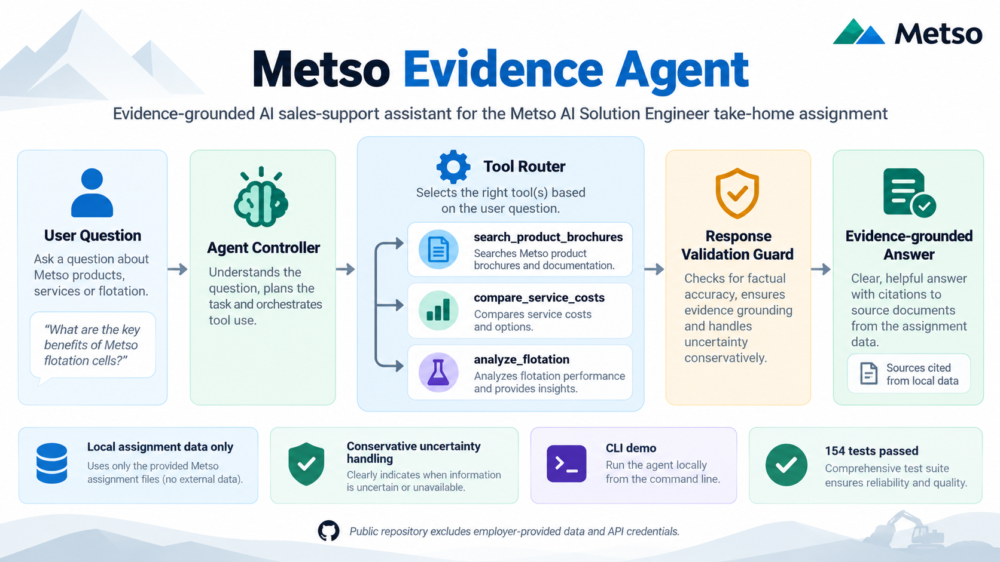
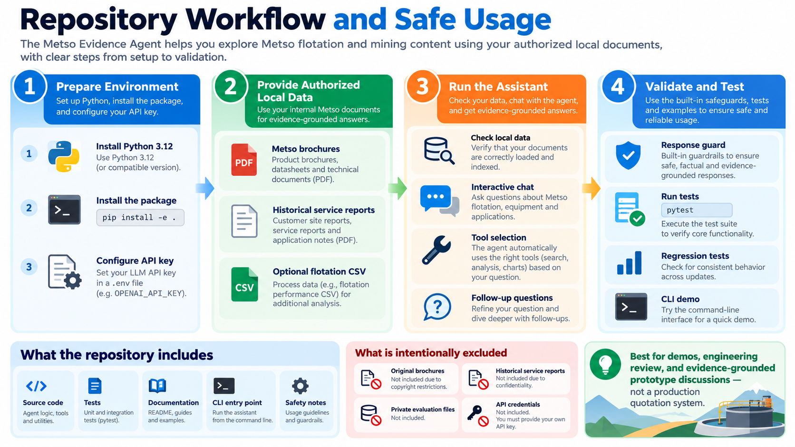

# Metso Evidence Agent

**An evidence-grounded conversational AI sales-support prototype** built for the Metso AI Solution Engineer take-home assignment.

The agent answers technical sales questions by selecting a relevant tool, examining authorized **local assignment materials**, and communicating what the evidence does—and does not—support. Its primary workflows are product-brochure retrieval and historical field-service cost comparison; descriptive flotation analysis is an optional extension.

> **Project boundary:** This is a take-home engineering prototype, not an official Metso product, commercial quotation system, certified engineering recommendation, or production plant-control application. Metso-provided source files and API credentials are **not distributed** in this repository.

## At a glance

| Capability | Evidence source | Main outcome |
| --- | --- | --- |
| Product recommendations | Supplied Metso brochures | Relevant product features, source references, and clarifying questions |
| Historical service costs | Supplied field-service reports | Comparable historical work, itemized evidence when available, and explicit limitations |
| Optional flotation analysis | Supplied flotation CSV | Descriptive statistics and threshold comparisons, not contractual acceptance decisions |
| Conversation and tool routing | LLM controller + local Python tools | Appropriate tool selection and follow-up dialogue |
| Response validation | Typed evidence and response guards | Conservative handling of unsupported or unverifiable claims |

## 1. System architecture



**Figure 1 — From question to evidence-grounded answer.** The agent interprets a user's question and decides whether to use brochure search, historical cost comparison, or flotation analytics. Tool outputs carry traceable source information. A response-validation layer checks for known unsupported claims and monetary/citation risks before the answer is shown. The guard reduces risk; it does **not** provide a mathematical guarantee that every generated statement is correct.

### Core tools

| Tool | Purpose | Important boundary |
| --- | --- | --- |
| `search_product_brochures` | Retrieve relevant passages from local product brochures and explain applicable product capabilities. | Do not invent specifications, suitability guarantees, or unsupported compatibility claims. |
| `compare_service_costs` | Interpret historical field-service reports and compare costs for relevant past work. | Past costs are **not** new commercial prices, and different currencies must not be silently mixed. |
| `analyze_flotation` | Calculate local dataset statistics and compare sample measurements to historical observations. | Historical frequencies and correlations are **not** quality acceptance standards or causal explanations. |

### How an answer is produced

1. **Interpret the request.** The conversational controller determines the user intent and any missing details.
2. **Select a tool.** An LLM-assisted controller routes the request to an appropriate Python tool rather than relying on a memorized answer.
3. **Use the correct source domain.** Product claims come from brochures; historical amounts come from service reports; process statistics come from the CSV.
4. **Validate the response.** Evidence and response guards detect selected citation, unsupported-claim, and cost-estimation issues. A conservative fallback can be returned when the evidence is insufficient.
5. **Explain uncertainty.** The assistant cites available source identifiers and asks follow-up questions instead of inventing omitted facts.

The current implementation uses a lightweight **command-line interface (CLI)**. A web application, dashboard, or cloud deployment is not required for this prototype.

## 2. Repository workflow and safe usage



**Figure 2 — Running and evaluating the repository.** First install Python and the package; next supply authorized local documents; then check data availability and use the CLI; finally run the tests and review the response safeguards. The bottom of the diagram distinguishes **public source code and documentation** from **private source materials and credentials** that must stay out of Git.

> **A note about the illustrations:** They are explanatory diagrams. The project provides CLI tools and descriptive statistics, not a plotting or dashboard feature. The factual evidence is read from local files, but running the LLM with `--allow-external-evidence` can transmit **selected excerpts** to the configured external API provider. Do not enable that flag unless such processing is authorized.

## 3. Installation

### Prerequisites

- **Python 3.12** (the package declares `>=3.12,<3.13`).
- A working internet connection **for LLM calls**; local checks do not need an external API call.
- An API key for the configured model provider (this prototype uses the OpenAI Python client).
- Authorized local copies of the assignment data for source-dependent workflows.

### Windows PowerShell

```powershell
# Clone the code-only repository.
git clone https://github.com/tembooo/metso-evidence-agent.git
cd metso-evidence-agent

# Create and activate a virtual environment.
py -3.12 -m venv .venv
.\.venv\Scripts\Activate.ps1

# Install the package and development/test dependencies.
python -m pip install -e ".[dev]"
```

If the PowerShell activation policy blocks activation, run `.\.venv\Scripts\python.exe` instead of `python` for the commands below; do not change system security policies just to run the project.

### macOS / Linux

```bash
git clone https://github.com/tembooo/metso-evidence-agent.git
cd metso-evidence-agent
python3.12 -m venv .venv
source .venv/bin/activate
python -m pip install -e '.[dev]'
```

### Configure the API

Copy `.env.example` to `.env` and replace the placeholder values **locally**:

```dotenv
OPENAI_API_KEY=YOUR_OWN_API_KEY
OPENAI_MODEL=YOUR_SUPPORTED_MODEL
RAW_DATA_DIR=raw/data
CACHE_DIR=local_cache
LOG_LEVEL=INFO
```

Do **not** commit `.env` or paste your real API key into issues, documentation, terminal screenshots, or a walkthrough video.

## 4. Authorized assignment data

The code repository is intentionally **data-free**. It cannot reproduce source-grounded answers using only a fresh public clone: the supplied employer materials are required and must be obtained through authorized channels.

Expected local layout:

```text
raw/
└── data/
    ├── brochures/
    │   ├── <brochure-name>.md
    │   └── <brochure-name>.pdf
    ├── HistoricalServices/
    │   └── FSR-XXXX.txt
    └── flotation_process_data_hourly.csv  # optional
```

- **Product retrieval:** Uses the locally supplied brochure texts; page references support traceability.
- **Service comparison:** Uses the locally supplied historical service reports, including their incomplete and heterogeneous records.
- **Flotation analytics:** Uses the optional CSV for descriptive measurements, historical thresholds, and data-quality observations.

The provided dataset used during development contained **12 brochure pairs (PDF + Markdown), 50 field-service reports, and an optional flotation CSV**. These files are **not** committed to GitHub.

## 5. Run the assistant

### Step 1 — Inspect the command-line options

```bash
python main.py --help
```

### Step 2 — Check local prerequisites (no external API call)

```bash
python main.py --check-local
```

This checks whether the implementation can read the configured local dependencies and evidence paths. With the authorized development dataset available, a verified run reported:

```text
Checking local-only dependencies (no network calls)...
Product retrieval usable: True
Service ledger readable: 50 reports
Check completed without external API calls.
```

A clean clone without private source data will not produce the same source-availability result.

### Step 3 — Start the conversation

```bash
python main.py --allow-external-evidence --verbose
```

**Consent boundary:** `--allow-external-evidence` explicitly permits selected private evidence excerpts to be transmitted to the configured API provider. Use it **only when permitted by the data owner and your organization's policies**. This is not an offline-only mode.

- `--verbose` displays tool names used during the interaction.
- Type `exit` at the `You >` prompt to end the session.
- Optional local logging can be enabled with `--session-log`, but saved transcripts should remain private.

For example:

```powershell
python main.py --allow-external-evidence --verbose --session-log ".\local_cache\demo_session.txt"
```

The session logger refuses to overwrite an existing file; choose a different filename for another run.

## 6. Reproducible demonstration scenarios

The following examples are the assignment's two required scenarios and one optional analysis scenario. Results depend on the authorized source files and, for the live agent, the configured model.

### Scenario A — Pressure-filter performance and product retrieval

```text
We have Larox pressure filters but performance drops whenever our feed grade changes
```

**Expected route:** `search_product_brochures`

**What a useful response should do:** Identify brochure-supported possibilities such as **Filter Optimizer** for changing process conditions, refer to relevant brochure sections, ask about the installed model and performance symptoms, and avoid promising a guaranteed improvement or assuming retrofit compatibility.

### Scenario B — Historical service budget for Chile

```text
A customer in Chile needs 12 filter cloths replaced on a Larox PF-DS tower press. What should I budget for the service visit?
```

**Expected route:** `compare_service_costs`

**What a useful response should do:** Find relevant prior work and distinguish a historical comparator from a new site-specific quotation. A development rehearsal identified **FSR-0027** as an analogous 12-cloth job and reconstructed a **provisional EUR 2,215.40 component sum** from a historical **Swedish** report. That figure is **not** a printed final invoice total and **not** a Chilean quotation. Site, travel, parts sourcing, taxes, and other unknowns require confirmation.

### Scenario C — Optional flotation quality context

```text
The customer is getting 3.1% silica and 64.5% iron in their concentrate. They think that's normal. What do you think?
```

**Expected route:** `analyze_flotation`

**What a useful response should do:** Compare these values to the actual historical dataset and distinguish statistical prevalence from a quality specification. In the development sample, **823 of 4,097 records (20.09%)** met the joint condition of silica `>= 3.1%` and iron `<= 64.5%`. This does **not** prove the readings are acceptable for the customer's contract or identify a process root cause.

## 7. Reliability and safety design

The agent is structured to favor **defensible evidence** over a fluent but unsupported answer.

| Risk | Approach |
| --- | --- |
| Invented product specifications | Restrict product-capability evidence to supplied brochure content and its references. |
| Fabricated report identifiers | Cross-check generated references against available source evidence. |
| Unrealistic cost precision | Separate documented source amounts from calculations and unknown scope. |
| Mixed-currency arithmetic | Do not aggregate or convert unlike currencies without documented conversion data. |
| Truncated or incomplete reports | Preserve provisional/missing status instead of calling an inferred amount a final total. |
| Quality acceptance overclaim | State that flotation statistics are descriptive and cannot define contractual limits. |
| Incomplete tool synthesis | Prefer a safe fallback; a combined product-and-cost query may return a partial answer. |

The guards implement targeted validation policies and are backed by tests. They do **not** replace human engineering, commercial review, or a formal safety assessment.

### Known limitations

- The public repository excludes employer-provided data, so source-dependent tests and the live demo require authorized local input files.
- Some combined-intent questions may select multiple tools but generate an incomplete final synthesis; this behavior is documented rather than presented as fully solved.
- The historical reports contain missing, bundled, or truncated amounts and inconsistent service scopes.
- The optional flotation analysis is historical and descriptive; it is not a predictive model or a process controller.
- NumPy deprecation warnings were observed in the development environment; they did not fail the tests but remain maintenance work.
- The application is a **prototype** and does not include enterprise access control, deployment hardening, or production monitoring.

## 8. Testing and evaluation

Run the test suite in an environment with the authorized local dataset:

```bash
python -m pytest -q
```

**Last documented local run: 154 tests passed, 18 non-failing warnings (20 October 2026).** This is a result from the development environment, **not** a claim that a clean data-free clone can pass every source-dependent test.

The tests exercise the main functional boundaries:

- Typed evidence schemas and provenance
- Brochure ingestion and retrieval
- Historical service-report parsing and cost computations
- Agent control flow and tool selection
- Response guards and adverse examples
- Optional flotation calculations
- Regression and CLI smoke cases

Additional evaluation notes: [`docs/evaluation_stage09.md`](docs/evaluation_stage09.md). CLI guidance: [`docs/stage10_cli_walkthrough.md`](docs/stage10_cli_walkthrough.md).

## 9. Repository map

```text
metso-evidence-agent/
├── 1.png                           # Architecture infographic
├── 2.png                           # Workflow and safe-usage infographic
├── README.md                       # You are here
├── main.py                         # Minimal CLI entry point
├── pyproject.toml                  # Dependencies and package metadata
├── .env.example                    # Placeholder configuration only
├── .gitignore                      # Private-data and cache exclusions
├── src/
│   └── metso_agent/
│       ├── agent/                  # Conversation controller and tool adapters
│       ├── analytics/              # Optional flotation statistics
│       ├── estimation/             # Historical cost comparison
│       ├── evaluation/             # Evaluation metrics
│       ├── ingestion/              # Service-report parsing
│       ├── retrieval/              # Brochure loading and search
│       ├── validation/             # Response safeguards
│       ├── cli.py
│       └── schemas.py
├── tests/                          # Unit, integration, and regression tests
├── scripts/                        # Development utilities and evaluation scripts
└── docs/                           # Public engineering documentation
```

Private data directories such as `raw/`, `local_cache/`, `docs/private/`, and local `.env` files exist **only** in authorized development environments and should not be added to the public repository.

## 10. Detailed documentation

| Topic | Document |
| --- | --- |
| Agent architecture and routing | [`docs/agent_controller.md`](docs/agent_controller.md) |
| Product retrieval | [`docs/product_retrieval.md`](docs/product_retrieval.md) |
| Service-report extraction | [`docs/service_extraction.md`](docs/service_extraction.md) |
| Cost estimation | [`docs/service_cost_estimation.md`](docs/service_cost_estimation.md) |
| Response validation | [`docs/response_validation.md`](docs/response_validation.md) |
| Flotation statistics | [`docs/flotation_analysis.md`](docs/flotation_analysis.md) |
| Evaluation and regression | [`docs/evaluation_stage09.md`](docs/evaluation_stage09.md) |
| CLI walkthrough | [`docs/stage10_cli_walkthrough.md`](docs/stage10_cli_walkthrough.md) |

## 11. Scope, reproducibility, and next steps

The prototype deliberately emphasizes **evidence provenance**, **deterministic local analytics where possible**, **clear separation of source domains**, and **safe uncertainty handling** over a complex UI or production deployment. For a larger corpus, retrieval and ingestion could be upgraded independently while retaining evidence boundaries and regression checks.

A public code review is possible from this repository, but an end-to-end reproduction needs the authorized assignment data and access to the configured LLM API. No employer-provided dataset or credential is included here.

## Author

**Arman Golbidi**  
MSc in Data-Centric Engineering, LUT University  
GitHub: [tembooo](https://github.com/tembooo)  
Repository: [tembooo/metso-evidence-agent](https://github.com/tembooo/metso-evidence-agent)

## License and attribution

No open-source license has been added. The public visibility of this repository does not grant blanket permission to reuse its contents. The project is an independent recruitment assignment prototype; the Metso name and relevant product names identify the assignment context and are not claims of official endorsement.
